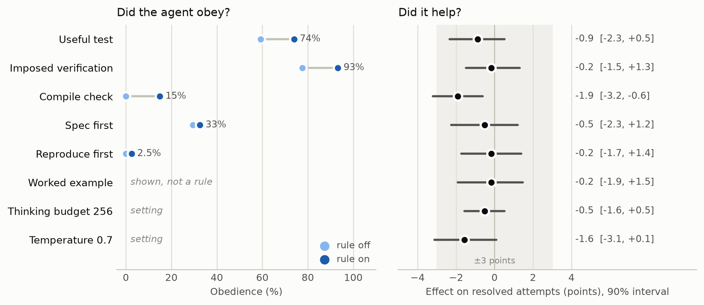
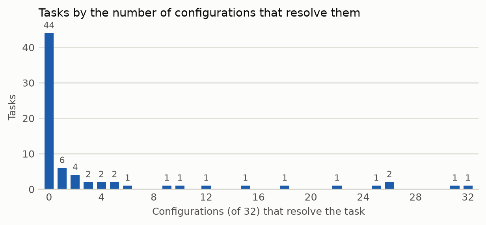

# Prompt Recipes Do Not Help a 4B Coding Agent, Even When It Follows Them: A Pre-registered Factorial Screening

## Abstract

Small coding agents are tuned with prompt recipes: run the tests, reproduce the bug first, compile
after each edit, show an example. A paired A/B comparison on 40 tasks has a 90% interval of about
±7.6 points, too wide to judge such recipes one at a time. We screened eight recipes at once for
Gemma 4 E4B in the official harness of the Gemma 4 Developer Agent competition, with a
pre-registered 2^(8-3) fractional factorial design: 32 configurations on 72 tasks, 2,304 attempts.
The agent resolved 11.7% of attempts. No recipe raised that rate: every upper 90% bound is at most
+1.5 points, six recipes are bounded within ±3 points, and two (temperature 0.7, a compile check)
lean negative but remain unresolved. Behaviour did change. Told that zero collected tests verify
nothing, the agent's pytest calls ran tests 74% of the time instead of 59%; imposed verification
raised checks after the edit from 78% to 93%. A rule to reproduce before editing was followed in
2.5% of the attempts given it. The best of the 32 configurations led the base prompt by 8 points;
in a registered replication on 576 fresh attempts, by 1.4 (-1.4 to +4.2). In exploratory analyses,
81% of attempts whose last test run was green still failed the hidden tests.

## 1. Introduction

Agents that run on one local GPU use small models, steered with words: reproduce the issue before
editing, run the closest test file, never submit without checking. Each recipe is cheap to add,
plausible, and usually justified by a single comparison.

Single comparisons cannot carry that weight. Runs of the same agent on the same tasks differ:
byte-identical bundles scored 0.18 and 0.13 on the public leaderboard [8], and 29 draws of six
identical file sets varied with a standard deviation of 1.56 tasks out of 58 [14]. At the task
rates of the model studied here, a paired comparison of two prompts on 40 tasks, one attempt per
arm, has a 90% interval of ±7.6 points. Two consequences follow: one team found nineteen of twenty
interventions indistinguishable from noise [8], and the significant results compare whole bundles.
A maximal against a minimal scaffold raised E4B from 10.0% to 15.4% [6], without saying which
component did it.

We screen eight recipes in one experiment. A fractional factorial design varies all of them at
once, so every attempt informs every recipe: each comparison uses 1,152 attempts per side, paired
within tasks, and gets an interval of about ±1.5 points. Because a rule that is ignored and a rule
that is followed but useless call for different responses, we also measure from the traces whether
the agent obeys each rule.

We contribute a pre-registered screening in which no recipe raises the resolved rate, a separation
of obedience from effect, a registered replication of the one configuration that stood out, an
exploratory account of why (a green test run is weak evidence; the task explains 58.5% of the
variance), and a reusable design for screening harness changes at the cost of one comparison.

## 2. Setting

**Harness.** The competition compiles declarative agents into a Google ADK agent running one Gemma
4 model behind vLLM. Given a GitHub issue and a repository, the agent works through six tools and
is scored SWE-bench style: hidden tests must pass on its patch.

**Model.** Gemma 4 E4B in the scorer's quantised checkpoint (W4A16).

**Base prompt.** All configurations share a structured system prompt of about 840 words: hard
limits (36 tool calls, 10 minutes, no edits to tests), a call plan, a procedure (locate, edit,
verify, submit) and decision rules. Recipes add to it or change parts of it.

**Tasks.** Of the 129 public tasks, 75 pass with their reference patch in the harness's subprocess
sandbox. In a control where the patch only adds an unrelated file, three of them still pass their
hidden tests and were excluded. The remaining 72 come from fastapi (29) and rich (43).

**Stack.** All attempts ran in private Kaggle kernels on 4×L4 GPUs with the scorer's vLLM settings
(tensor parallel 4, bfloat16, the gemma4 tool and reasoning parsers, 32k context), the official
harness, and eight attempts in flight. The scorer runs tasks one at a time under a cap each
submission sets. In a benchmark, decoding slowed from 8.6 to 11.4 ms per token at eight concurrent
requests, so we raised our cap from 7 to 10 minutes, without measuring whether this compensates.

## 3. Recipes, design and analysis

**Recipes.** Each recipe has two levels (Table 1): six are instructions, two are sampling settings,
and each comes from a published claim or from our earlier runs of the same agent.

| | Recipe | Off | On | Source |
|---|---|---|---|---|
| A | Temperature 0.7 | 0.2 | 0.7 | 0.2 in our earlier runs and public bundles |
| B | Thinking budget 256 | 4,096 tokens | 256 tokens | a public 31B bundle at 0.20 used 256 [16] |
| C | Spec first | absent | list names, messages, edge cases before acting | specification information beats test feedback [9] |
| D | Reproduce first | absent | a script in /tmp that must fail before the edit | evidence first helps [10]; reproduction tests can mislead [11] |
| E | Imposed verification | verify in at most 2-3 calls | no submission before a check; spend the budget checking | E4B stops early [6] |
| F | Useful test | add `-k`; failures from missing fixtures may be ignored | run the whole test file; zero tests is not a check; no such excuse | 24-45% of E4B pytest calls ran no test in four earlier runs |
| G | Compile check | absent | `python -m py_compile` after every edit | 9-16% of E4B attempts had syntax errors in the same runs; linting on edit [12] |
| H | Worked example | absent | one session on a made-up project | a 31B agent acted on what its harness showed it [15] |

*Table 1. The eight recipes. Both levels of F pipe test output through `tail -40`. Earlier runs (F,
G): another stack, not in the released records.*

**Design.** A 2^(8-3) fractional factorial of resolution IV: recipes A to E are crossed in full,
and F = ABC, G = ABD, H = -ACDE. Each recipe is on in 16 of the 32 configurations, and no main
effect is aliased with a two-way interaction. The two-way interactions of E and H with every other
recipe are unaliased (13 of 28); the others are aliased in pairs or triples and not interpreted. An
inactive recipe leaves no trace in the prompt, and the worked example shows only the steps of
active recipes. Each configuration ran once on each task: 2,304 attempts, in three kernels of 24
tasks stratified by repository, in a seeded random order.

**Pre-registration.** Hypotheses, reading rules, predictions, run files and the analysis script
were committed with their SHA-256 before the main run. An excluded pilot of 96 attempts checked the
infrastructure and the obedience measures, with resolved comparisons hidden; it changed one
measure, and the predictions were written after its obedience output. There was no deviation. An
addendum, written after the main results and frozen before its run, registers the replication of
Section 4; other analyses beyond the registration are labelled exploratory.

**Analysis.** For each recipe and task, the effect is the mean outcome with the recipe on minus the
mean with it off; the reported effect is the mean over tasks. Intervals are 90% task bootstraps
(2,000 resamples); p values flip the sign of task differences (10,000 permutations) and are
Holm-adjusted over the eight primary tests. Reading rules: a recipe **helps** or **hurts** if its
interval excludes zero and its Holm p is below 0.05; it has **no effect beyond 3 points** if its
interval lies within (-3, +3); otherwise it is **unresolved**. Three points is a fifth of the base
rate we expected (15%), or 1.7 tasks of 58 on the leaderboard.

**Obedience.** Pattern-based measures from the tool calls of each trace: a reproduction script run
before the first edit; a test or script run after it; the share of pytest calls whose summary
reports at least one test passed, failed or in error; `py_compile` run after an edit; and, for spec
first, a first message that names at least three identifiers of the issue and runs to 600
characters.

## 4. Results

**Overall.** E4B resolved 11.7% of attempts (fastapi 16.5%, rich 8.5%) and 28 of the 72 tasks at
least once. 92% of attempts left a non-empty patch. Attempts took 192 seconds and 15.3 tool calls
on average; 50 ran the full 10 minutes and the harness stopped 45 at the tool-call cap. No attempt
was lost to infrastructure, and identical patches always received the same verdict.

**No recipe helps.** Six recipes have no effect beyond 3 points (Table 2, Figure 1). Two are
unresolved: temperature 0.7, whose interval reaches -3.1, and the compile check, whose interval
excludes zero (p = 0.023) but whose Holm-adjusted p is 0.18. No estimate is positive, and no upper
bound exceeds +1.5 points.

| Recipe | Effect (points) | 90% interval | Holm p | Reading |
|---|---|---|---|---|
| Reproduce first | -0.2 | [-1.7, +1.4] | 1.00 | no effect beyond 3 points |
| Imposed verification | -0.2 | [-1.5, +1.3] | 1.00 | no effect beyond 3 points |
| Worked example | -0.2 | [-1.9, +1.5] | 1.00 | no effect beyond 3 points |
| Thinking budget 256 | -0.5 | [-1.6, +0.5] | 1.00 | no effect beyond 3 points |
| Spec first | -0.5 | [-2.3, +1.2] | 1.00 | no effect beyond 3 points |
| Useful test | -0.9 | [-2.3, +0.5] | 1.00 | no effect beyond 3 points |
| Temperature 0.7 | -1.6 | [-3.1, +0.1] | 1.00 | unresolved |
| Compile check | -1.9 | [-3.2, -0.6] | 0.18 | unresolved |

*Table 2. Effect of each recipe on resolved attempts, pre-registered analysis.*

*Figure 1. Left: obedience with the rule off and on. Right: effect on resolved attempts with 90%
intervals; the band marks ±3 points.*

**Obedience.** Two rules change behaviour strongly. Under the useful-test rule, the share of pytest
calls that run a test rises from 59% to 74% (48% to 62% when summaries with errors only are not
counted), the last check is a real test 21 points more often, and an empty last check 12 points
less often. Imposed verification raises checks after the edit from 78% to 93% and adds two tool
calls. The compile check is followed in 15% of the attempts given it. A reproduction script runs
before the edit in 2.5% of attempts told to write one; 37% run one at some point, mostly after
editing. Spec first barely moves its measure (29% to 33%). None of these changes reaches the
resolved rate.

**Costs.** Checking costs time: imposed verification adds 22 seconds per attempt (90% interval 14
to 31), the worked example 17, the useful test 14. The thinking budget of 256 saves 16 seconds (7
to 25) but leaves an empty patch 3.4 points more often.

**Predictions.** Four of eight registered predictions held. Four failed: the useful test and the
worked example were expected to help, imposed verification to help or stay unresolved, and
temperature 0.7 to hurt.

**Exploratory: the worked example.** The example always shows a real test file run and passing. It
raised the share of pytest calls that run a test from 50% to 67% without the useful-test rule and
from 68% to 79% with it, and compile obedience from 9% to 21% among attempts given that rule: on
these two measures, the demonstration moves the agent about as much as the rule does.

**Exploratory: green checks.** 855 attempts ended on a green test run, and 81% of them failed the
hidden tests, against 92% of the others (within tasks, green adds 6.2 points; 2.9 to 9.9). The
useful-test rule raised green last checks from 28% to 46% of attempts, while the resolved rate went
from 12.2% to 11.3%.

**Exploratory: where the variance lies.** No two-way interaction survives correction: of 13, the
largest is imposed verification by reproduce first (+1.9 points; 0.0 to 3.9; p = 0.14) and the
smallest p is 0.052 (compile check by worked example, -1.6). The task explains 58.5% of the
variance of attempt outcomes. The standard deviation of configuration means is 2.7 points, inside
the 1.9 to 2.9 range that chance alone produces with these tasks. Forty-four tasks are never
resolved, one always, and 27 sometimes (Figure 2).

*Figure 2. Number of tasks by how many of the 32 configurations resolve them.*

**Replication of the best configuration.** Configuration `s04` (spec first, useful test, worked
example) resolved 15 of 72 tasks, against 9 for the base prompt (`reproduce.py` lists the 32
configurations, from 6.9% to 20.8%); if configurations changed nothing, the best of 32 would reach
15 in 1.6% of simulations. The addendum registered four fresh attempts per task for both, 576
attempts. `s04` resolved 12.2% and the base prompt 10.8%: +1.4 points (-1.4 to +4.2; p = 0.56),
unresolved by the registered rule. The 8-point lead did not hold; up to 4 points are not excluded.
`s04` ended on a green test run in 53% of attempts against 21% and took 37 seconds longer.

## 5. Discussion

**The process changed, the outcome did not.** The rules worked as instructions: more real tests,
more checks after editing, more green test runs. The traces suggest why this did not help. The
agent checks its patch against existing test files, which wrong patches also pass; the hidden tests
encode the behaviour the issue asks for, which existing tests rarely cover. A green run is weak
evidence: 81% of green attempts failed. Making the agent check more truthfully moved it from no
evidence to weak evidence.

**Ignored rules are harness candidates.** Reproducing before editing (2.5%) and compiling (15%)
were mostly ignored. A harness can enforce such steps rather than ask for them: linting on every
edit [12], an execution layer that postpones edits until evidence is gathered [10], or structure
instead of prompt rules [7]. We did not test enforcement.

**Most of the outcome is set by the task.** Forty-four tasks were never resolved in 32 attempts,
and the configuration spread is what chance alone predicts. Recipes act, if at all, on the 27 tasks
that are sometimes solved: raising the average by 3 points would require about 8 points more
success on each of them.

**Practical advice.** On top of a structured base prompt, these recipes are not worth tuning for
E4B. Judge a rule on whether it is obeyed and whether it helps: "no effect" means something
different in each case.  Rerun the best of many configurations before believing it. A fractional
factorial screen costs one well-powered comparison, and the design transfers to other agents.

## 6. Threats to validity

**Base prompt.** Effects are measured on top of a long structured prompt; on a minimal prompt the
recipes could matter more.

**Tasks.** All 72 tasks were used in earlier work, and the useful-test and compile-check recipes
came from traces on them; recipes suggested by these tasks still failed on them. The tasks come
from two repositories, and the competition's hidden tasks from private ones. 12.6% of fastapi
pytest calls stop on a module missing from the sandbox, which hampers checking there.

**One model.** Results concern E4B; a larger model might turn the same behaviours into better
patches, though a full scaffold helped E4B but not 12B or 26B [6].

**Levels and measures.** Each recipe was tested at one wording and one level. Obedience measures
are pattern-based; the one for spec first is weak, so "ignored" is less certain for that recipe.

**Budget and averages.** The 10-minute cap with eight concurrent attempts differs from the scorer's
sequential runs; 2% of attempts hit it. The runner's tool calls are synchronous: a slow command
stalls the seven other attempts, so durations and time-cap stops are overstated; attempts ran in
random order, which spreads the stalls over configurations. The primary test is an average over
tasks: a recipe could help some tasks and hurt others.

**Averaged effects.** Each effect is averaged over the other seven recipes, and no configuration
has exactly one on: a recipe that helps only alone would be missed. All eight estimates are
negative, and their sum is -5.9 points (-10.6 to -1.6; p = 0.04, exploratory).

## 7. Related work

**Evaluation noise.** A repeated-run study attributes 53% of outcome variance to the issue, 42% to
the run and 4.6% to the model-issue interaction [1]. The same lightweight model differs by up to 44
points across harnesses [2], and a position paper calls for disclosing the harness and decomposing
variance [3]. We apply a factorial protocol inside one harness.

**Prompt and scaffold studies.** For frontier agents, instruction-file structure barely changes
adherence [4] and context files have small or no effects [5]. In this competition, a full scaffold
helped only E4B [6], a 31B agent followed a prompt rule 20 times out of 20 with no gain [7], and
nineteen of twenty interventions were indistinguishable from noise [8]. We separate eight
components at once, with intervals tight enough to bound them.

**What helps repair.** Specification information, there drawn from the reference patch, is worth
more than test feedback for repairing failed states [9]. An execution layer that delays edits until
evidence is gathered helps [10], while generated reproduction tests can mislead [11]. Linting on
edit helped GPT-4 Turbo in SWE-agent [12]. One study argues that, for strong models, verifying
solutions has become harder than generating them [13]. Our results add a small-model case in which
more and truer checking did not translate into success.

## Reproducibility

Run files, the 32 prompts, the scripts, the pre-registration and its addendum, with SHA-256 hashes,
are at https://github.com/matisdsp/gemma-4-developer-agent. The pre-registration commit (97bbbf5)
is dated before the main run, but the date is self-declared: the repository became public
afterwards. The addendum has an OpenTimestamps receipt anchored before its run ended. Records per
attempt (no task text) and CPU scripts reproduce every number of Sections 4 to 6. The public tasks
are not redistributed. The main run and the replication took about 21 hours of 4×L4 time on the
free Kaggle quota.

## Use of AI tools

The author was assisted by AI tools for writing the code and the text of this report.

## References

1. X. Shi et al. Hard Issue, Weak Model, or Bad Run? Rethinking Failure Prediction for Coding Agents. arXiv:2611.08285, 2026.
2. L. Zhao et al. Pairing Matters: Performance, Failures, and Efficiency in Lightweight Coding Agents. arXiv:2610.32131, 2026.
3. Y. Zhang et al. Stop Comparing LLM Agents Without Disclosing the Harness. arXiv:2605.23950, 2026.
4. D. McMillan. Instruction Adherence in Coding Agent Configuration Files: A Factorial Study of Four File-Structure Variables. arXiv:2605.10039, 2026.
5. P. Khatri. Do Context Files Help Coding Agents? A Two-Agent Ablation Study on Real Repositories. arXiv:2607.27250, 2026.
6. T. Toeda. Scaffolding Helps the Smallest Gemma 4 Agent, Not the Larger Ones. Zenodo, doi:10.5281/zenodo.23813680, 2026.
7. kb2326. Ask or Enforce? Pre-registered test of prompt rules vs agent structure for Gemma 4 31B under a fixed budget. https://github.com/kb2326/gemma4-ask-or-enforce, 2026.
8. fjcarmona78. Most Agent Improvements Are Noise: A Calibrated Study of a Gemma 4 31B Coding Agent. https://github.com/fjcarmona78/gemma4-agent-noise-study, 2026.
9. S. Lyu et al. Where Should a Stuck Agent Spend Its Next Tokens? Causal Attribution of Inference-Time Resources. arXiv:2610.28834, 2026.
10. Y. Xu et al. Preventing Premature Commitment in Coding Agents with an Evidence-Conditioned Execution Layer. arXiv:2607.28815, 2026.
11. Y. Guo et al. SWE-Doctor: Guiding Software Engineering Agents with Runtime Diagnosis from Multi-Faceted Bug Reproduction Tests. arXiv:2607.00990, 2026.
12. J. Yang et al. SWE-agent: Agent-Computer Interfaces Enable Automated Software Engineering. arXiv:2405.15793, 2024.
13. B. Wang et al. The Verification Horizon: No Silver Bullet for Coding Agent Rewards. arXiv:2606.26300, 2026.
14. D. Afshar. Gemma 4: most-run public config averages 10/58. Kaggle notebook, https://www.kaggle.com/code/dariushafshar/gemma-4-most-run-public-config-averages-10-58, 2026.
15. lspecian. gemma4-moving-failures. https://github.com/lspecian/gemma4-moving-failures, 2026.
16. XingLing. Same 8 minutes, scores from 0.05 to 0.20. Kaggle notebook, https://www.kaggle.com/code/xingling666/same-8-minutes-scores-from-0-05-to-0-20, 2026.
